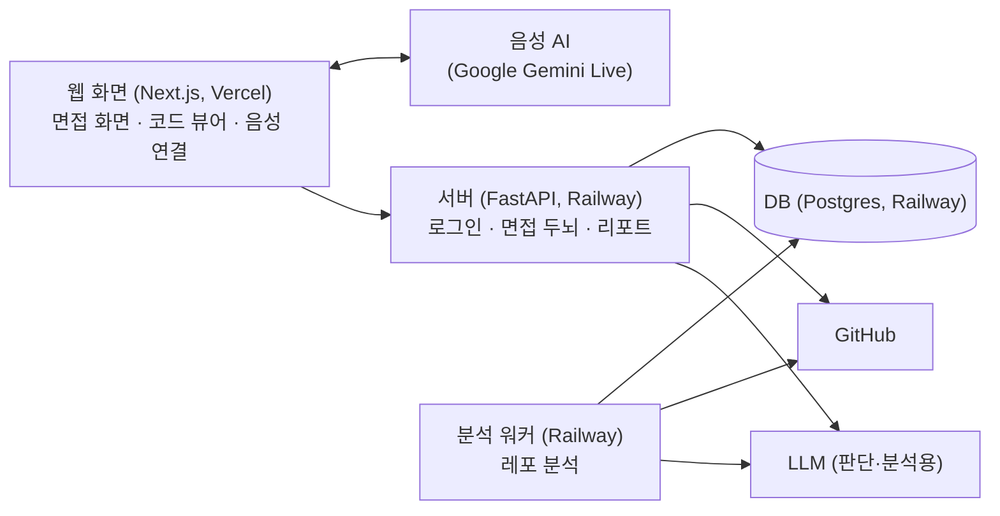

# GitInsight 2.0 프로젝트 소개

## 1. 한 줄 요약
GitHub 레포를 분석해서, **지원자가 실제로 작업한 코드와 커밋 이력을 근거로**
AI 면접관이 음성으로 질문하고 꼬리질문까지 이어 가는 모의 기술면접 서비스입니다.

## 2. 왜 새로 만드나
기존 GitInsight(KNU-Upstage 프로젝트)는 Upstage API 지원이 끝났고, 코드를 확인해 보니 구조적인 한계가 있었습니다.

| 기존 서비스의 문제 | 새 버전에서 바꾸는 점 |
|---|---|
| 레포에서 파일 3개, 파일당 800자만 읽음 | 레포 전체 구조를 분석하고, 핵심 코드는 깊게 분석 |
| 질문에 나오는 줄 번호를 LLM이 추측해서 틀릴 수 있음 | 코드 구조 분석으로 얻은 정확한 위치만 사용 |
| 질문 5개를 미리 만들어 순서대로 냄 | 답변을 듣고 그 자리에서 꼬리질문을 만듦 |
| 코드 검색(RAG)이 실제로는 항상 빈 결과를 돌려줌 | 함수 목록 기반 검색으로 단순하고 확실하게 |
| 서버를 재시작하면 면접 기록이 사라짐 | DB에 저장 |
| 텍스트 채팅만 지원 | 실시간 음성 대화 |

기존 코드는 재사용하지 않고 새로 만듭니다.

## 3. 사용자 흐름
1. GitHub로 로그인하고 면접 볼 레포를 고른다 (비공개 레포 포함)
2. 서비스가 레포를 분석한다: 핵심 함수, 내가 작업한 코드, 변경 이력
3. AI 면접관이 음성으로 질문하고, 화면에 관련 코드가 하이라이트된다
4. 마이크로 답변하면, 답변 내용에 따라 꼬리질문이나 힌트가 나온다
5. 면접이 끝나면 리포트가 나온다. 피드백마다 근거가 된 내 답변과 코드 위치가 연결된다
6. 다시 면접을 보면 이전 결과와 비교한 역량 변화를 볼 수 있다

## 4. 비슷한 서비스와 우리의 차이

| 서비스 | 하는 일 | 우리와의 차이 |
|---|---|---|
| Open Interview (오픈소스) | 프로젝트 zip과 이력서를 올리면 코드를 읽고 면접 연습 | zip 업로드라 **git 이력이 없음**. 우리는 커밋 이력으로 "내가 작업한 코드"와 "왜 이렇게 바꿨나"를 물을 수 있음 |
| DeepInterview, MockFlow-AI | 이력서·JD 기반 음성 면접 | 지원자 본인의 코드를 보지 않음 |
| Final Round AI | 실제 면접 중에 답을 띄워 주는 도구 | 우리는 실력을 키우는 연습용 |

**우리의 차별점**
1. 커밋 이력을 근거로 "내가 실제로 작업한 코드"와 "변경 이유"를 질문
2. 함수 단위로 정확한 코드 하이라이트
3. 한국어 실시간 음성으로 꼬리질문
4. 답변 인용문과 코드가 연결된 리포트
5. 이전 면접 대비 변화

**홍보 문구(안):** "내가 실제로 기여한 코드와 변경 이력을 바탕으로 질문하는 AI 기술면접 코치"

## 5. 전체 구조

**구성 요소별 역할**
- **음성 AI:** 말하고 듣기만 합니다. 끼어들기 처리와 자연스러운 대화 진행을 맡습니다.
- **면접 두뇌(서버):** 답변을 판단하고, 다음에 무엇을 물을지 정하고, 점수를 매깁니다.
- **분석 워커:** 레포를 받아 분석하고, 분석이 끝나면 원본 코드를 삭제합니다.
- **웹 화면:** 음성 AI와 서버 사이를 이어 주고, 코드를 하이라이트해서 보여 줍니다.

## 6. 핵심 설계 원칙
1. **음성과 판단을 분리합니다.** 음성 AI는 대화만 하고, 무엇을 물을지는 서버가 정합니다. 그래서 판단용 LLM을 나중에 바꿔도 음성 쪽은 손대지 않아도 됩니다.
2. **코드 위치는 LLM이 만들지 않습니다.** 분석해 둔 함수 목록에서 고르게만 하고, 줄 번호는 분석 결과에서 가져옵니다. 그래서 하이라이트 위치가 항상 맞습니다.
3. **최종 결정은 서버가 합니다.** LLM은 "답변이 기대한 내용을 다뤘는가"만 판단합니다. 다음 질문, 점수, 상태 변경은 서버 규칙이 정합니다.
4. **원본 코드는 저장하지 않습니다.** 분석이 끝나면 삭제하고, 요약과 위치 정보만 남깁니다. 화면에 코드를 보여 줄 때는 그때그때 GitHub에서 받아옵니다.
5. **기여 분석은 점수에 쓰지 않습니다.** git 이력은 "마지막으로 수정한 사람"을 보여 줄 뿐 실제 작성자와 다를 수 있습니다. 그래서 질문 순서와 질문 표현에만 쓰고, 점수에는 반영하지 않습니다.
6. **항상 대비책을 둡니다.** 음성이 안 되면 텍스트 모드로, LLM이 안 되면 미리 만들어 둔 질문으로, 분석이 안 되면 미리 저장한 분석 결과로 데모를 이어 갑니다.

## 7. 이번에 만들 것과 뺄 것

**만드는 것 (MVP)**
- GitHub 로그인과 비공개 레포 연동
- 레포 분석: 핵심 함수, 정확한 위치, 기여 근거, 최근 변경 이력
- 실시간 한국어 음성 면접과 꼬리질문
- 텍스트 모드 (테스트용이자 장애 대비용)
- 근거가 연결된 평가 리포트
- 이전 면접과 비교

**빼는 것**
- 이력서 PDF 분석
- 코드 리뷰와 개선 과제 추천
- 아바타
- Python, TS/JS 외 언어의 상세 분석

**일정이 밀리면 줄일 순서**
1. Java·Go 분석
2. 변경 이력 질문
3. 채용공고 맞춤 면접
4. 성장 차트
5. 모범답안

## 8. 역할 구성

| 역할 | 하는 일 |
|---|---|
| A. 분석 엔진 | 레포 분석, 기여 근거, 면접 주제 선정 |
| B. 면접 두뇌 (팀장) | 꼬리질문 로직, 평가, 모듈 간 계약 관리 |
| C. 웹·실시간 음성 | 면접 화면, 코드 뷰어, 음성 연결, 음성 API 비교 테스트 |
| D. 플랫폼·발표 | GitHub 로그인, 배포, 자동 테스트, 리포트 화면, 기록 정리, 발표 자료 |

- 코드 리뷰 짝: A ↔ B, C ↔ D
- 30분 넘게 막히면 바로 공유합니다.

## 9. 진행 방식

**계약을 먼저 정합니다.** 첫 작업으로 모듈끼리 주고받을 데이터 형식(계약)과 샘플 데이터를 정합니다. 그러면 다른 파트가 완성되기를 기다리지 않고 네 명이 동시에 개발할 수 있습니다.

**관문으로 진행 상황을 확인합니다.**

| 관문 | 확인할 것 |
|---|---|
| G1 | 한국어 음성 대화 성공, 음성 AI 결정 |
| G2 | 실제 비공개 레포에서 정확한 코드 하이라이트 |
| G3 | 실제 레포로 텍스트 꼬리질문 면접 |
| G4 | **음성 면접 처음부터 끝까지 완주 (11/16 목표)** |
| G5 | 리포트까지 포함한 전체 데모 흐름 |

**고정된 날짜**
- 11/16: G4 목표
- 11/19: 기능 동결 (새 기능 추가 중단)
- 11/20~21: 해커톤

**협업 규칙(안)**
- `main` 브랜치는 보호하고, 기능 브랜치로 작업한 뒤 PR로 리뷰 1명을 받습니다.
- 계약 변경은 2명이 승인해야 합니다.
- 하루 15분 스탠드업을 합니다.

## 10. 첫 회의 안건
1. 역할 확정
2. 음성 AI 선정 규칙: 테스트 결과로 어떻게 결정할지 미리 합의
3. 판단용 LLM 기본값: OpenAI로 시작하고 나중에 바꿀 수 있게 함(안)
4. API 결제 계정과 예산 상한 ($100 제안. 예상 사용액은 면접 50회 기준 약 $65~75)
5. API 키 공유 방식: 메신저로 공유하지 않기
6. GitHub 팀 조직 만들기
7. 데모 레포 사용 동의: 기존 gitinsight_agent를 비공개로 복제해서 쓰면 **팀원 커밋 정보가 분석과 화면에 나옴**
8. 해커톤 주최 측에 확인할 것: 사전 개발 범위, 외부 API 사용, 제출물 형식, 현장 네트워크

## 11. 용어 설명

| 용어 | 뜻 |
|---|---|
| tree-sitter | 코드를 읽어서 함수와 클래스가 몇 번째 줄부터 몇 번째 줄까지인지 알려 주는 라이브러리 |
| git blame | 파일의 각 줄을 마지막으로 수정한 커밋과 사람을 보여 주는 git 명령어 |
| GitHub App | GitHub 연동 방식의 하나. 레포를 읽기 전용으로만 접근하도록 권한을 좁힐 수 있음 |
| GPT-Live / Gemini Live | 사람처럼 실시간으로 듣고 말하는 음성 AI API |
| 위임 (delegation) | 음성 AI가 "다음에 뭐라고 할지"를 우리 서버에 물어보는 방식 |
| WebRTC | 브라우저에서 실시간으로 음성을 주고받는 기술 |
| VAD | 사용자가 말을 시작하고 끝냈는지 감지하는 기능 |
| 끼어들기 (barge-in) | AI가 말하는 도중에 사용자가 말하면 AI가 멈추는 기능 |
| 계약 (contract) | 모듈끼리 주고받는 데이터의 형식 |
| 샘플 데이터 (fixture) | 개발과 테스트용으로 미리 만들어 둔 가짜 데이터 |
| PoC | 실제로 되는지 먼저 작게 만들어 확인하는 테스트 |
| 관문 (gate) | 다음 단계로 넘어가기 전에 꼭 통과해야 하는 확인 지점 |
